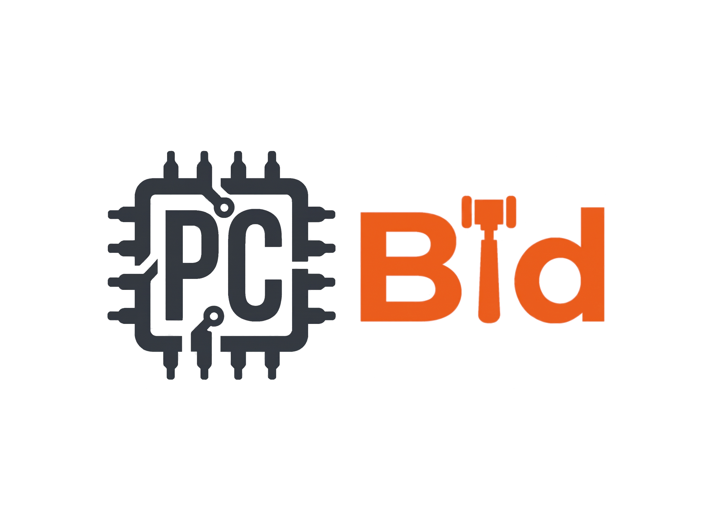

<p align="center">
  
</p>

# PCBid - Website Đấu Giá Linh Kiện PC Cũ

Đồ án môn học: **IE104 - Internet & Công nghệ Web**
Giảng viên hướng dẫn: **ThS. Võ Tấn Khoa**
Trường: **Đại học Công nghệ Thông tin - ĐHQG-HCM (UIT)**
Nhóm thực hiện: **Nguyễn Hùng Phong · Nguyễn Nhật Huy · Huỳnh Nhật Minh · Nguyễn Gia Huy**

🔗 **Bản chạy trực tiếp:** <https://pc-bid-organization.github.io/pc-bid/>

---

## Mục lục

1. [Giới thiệu](#1-giới-thiệu)
2. [Tính năng nổi bật](#2-tính-năng-nổi-bật)
3. [Công nghệ & ràng buộc kỹ thuật](#3-công-nghệ--ràng-buộc-kỹ-thuật)
4. [8 màn hình chính thức](#4-8-màn-hình-chính-thức)
5. [Cấu trúc thư mục](#5-cấu-trúc-thư-mục)
6. [Mô phỏng dữ liệu bằng localStorage](#6-mô-phỏng-dữ-liệu-bằng-localstorage)
7. [Hướng dẫn chạy dự án](#7-hướng-dẫn-chạy-dự-án)
8. [Tài khoản demo & kịch bản trình diễn](#8-tài-khoản-demo--kịch-bản-trình-diễn)
9. [Quy chuẩn lập trình](#9-quy-chuẩn-lập-trình)
10. [Quy trình Git của nhóm](#10-quy-trình-git-của-nhóm)
11. [Giới hạn của bản mô phỏng](#11-giới-hạn-của-bản-mô-phỏng)
12. [Kiểm tra chất lượng](#12-kiểm-tra-chất-lượng)

---

## 1. Giới thiệu

**PCBid** là website mô phỏng sàn đấu giá trực tuyến dành riêng cho **linh kiện máy tính đã qua sử dụng** (GPU, CPU, Mainboard, RAM, SSD/HDD, PSU, tản nhiệt, vỏ case).

Khác với trang thương mại điện tử thông thường, trọng tâm của PCBid là **đấu giá theo thời gian thực**: người bán đặt giá khởi điểm, bước giá và thời hạn; người mua theo dõi đồng hồ đếm ngược, trả giá cạnh tranh, giữ cọc 10% và hoàn tất đơn hàng sau khi thắng.

Toàn bộ website chạy **100% phía trình duyệt** (HTML/CSS/JavaScript thuần). Các tính năng vốn cần máy chủ như nhiều người cùng đấu giá, thanh toán, nhắn tin, đơn hàng đều được **mô phỏng bằng `localStorage`** đúng theo yêu cầu học phần.

---

## 2. Tính năng nổi bật

### Đấu giá thời gian thực
- Đồng hồ đếm ngược theo giây, kiểm tra bước giá tối thiểu, chặn người bán tự đặt giá phiên của mình.
- **Lịch sử đặt giá** gồm lượt đặt thật và lượt mẫu sinh cố định theo từng phiên, hiển thị **họ tên + UID che bớt** (`#PCB-7K***XA`).
- **Bot đặt giá mô phỏng** (`js/bot-bidder.js`): cứ 15–60 giây một người dùng mẫu đặt giá thật vào một phiên đang mở. Chỉ một tab chạy bot nhờ cơ chế khóa trong `localStorage`, có mức trần giá theo giá thị trường.
- **Băng chuyền "Trực tiếp sàn đấu giá"** ở trang chủ hiện các lượt đặt mới nhất; bấm tên người để mở hồ sơ, bấm tên linh kiện để mở phiên.
- Trang chi tiết tự cập nhật giá, số lượt, lịch sử và báo ngay khi bạn **bị vượt giá**.

### Kiểm định phần cứng PCBid Lab
- Mỗi phiên vừa đăng phải qua **kiểm định 1 phút** (mô phỏng gửi linh kiện tới PCBid Lab) trước khi mở đấu giá. Người bán không tự chọn chứng nhận.
- Trong lúc chờ: thẻ sản phẩm có tem **"Chờ kiểm định"**, nút đặt giá bị khóa, bot không đặt giá vào phiên và **đồng hồ đếm ngược đứng yên**, chỉ chạy khi kiểm định xong.
- Nút **"Bỏ qua chờ kiểm định (demo)"** trên trang chi tiết giúp trình diễn ngay không phải đợi.
- Kiểm định xong, phiên hiện trạng thái **"Đạt chuẩn - PCBid Verified"** kèm nút mở **phiếu kiểm định riêng của từng sản phẩm**: mã chứng chỉ `#UIT-QC-<năm>-<mã phiên>`, xếp hạng, kiểm định viên, ngày cấp và kết quả đo theo loại linh kiện (Furmark, MemTest86, CrystalDiskInfo…).

### Ví ảo, tiền cọc & quy trình sau khi thắng
- Mỗi lượt đang dẫn đầu bị **giữ cọc 10%**; bị vượt giá thì cọc tự hoàn.
- **Phiên kết thúc** → người thắng tiếp tục bị giữ cọc, đơn hàng chuyển sang **"Chờ thanh toán"** (hạn 1 phút để dễ trình diễn):
  1. Người mua chọn địa chỉ nhận hàng và thanh toán phần còn lại từ ví ảo.
  2. Người bán xác nhận đã giao hàng.
  3. Người mua xác nhận đã nhận → tiền chuyển vào ví người bán.
  4. Quá hạn thanh toán → người mua **mất cọc**, cọc chuyển cho người bán, phiên có thể đăng bán lại.
- Sổ giao dịch ví (`pcbid_wallet_ledger`) ghi mọi khoản cộng / trừ của cả người mua lẫn người bán.
- Nút **"Kết thúc phiên ngay (demo)"** giúp trình diễn toàn bộ quy trình mà không phải chờ hết giờ.

### Quản lý đấu giá tách hai luồng Mua / Bán
- Icon xe hàng trên header mở khu vực **Quản lý đấu giá**, tách biệt với phần cài đặt tài khoản.
- **Mua hàng:** Phiên đang tham gia · Đơn mua · Danh sách theo dõi.
- **Bán hàng:** Phiên đang bán · Đơn bán.
- Thẻ đơn hàng có dòng thời gian 4 bước, đồng hồ hạn thanh toán, nút thao tác theo vai trò và nút nhắn tin với bên còn lại.

### Đăng bán linh kiện
- Chọn mẫu từ catalogue chuẩn để tự điền thông số, bổ sung thông số riêng.
- Tải tối đa 6 ảnh (nén trước khi lưu), chọn ảnh bìa, gợi ý ảnh liên quan theo mẫu.
- Thanh tiến trình 3 bước, xem trước thẻ đấu giá trực tiếp; các ô chọn dùng danh sách xổ xuống riêng của PCBid, giống nhau trên máy tính và điện thoại.
- Đăng xong có đồng hồ 10 giây tự chuyển sang trang Sàn đấu giá, phiên vừa đăng được ưu tiên hiển thị kèm nhãn **"Bạn vừa đăng"**.
- Người bán có bảng quản lý riêng trên trang chi tiết: đóng phiên ngay, đăng bán lại, xem lịch sử đặt giá.

### Tài khoản, hồ sơ & quyền riêng tư
- Đăng nhập **kiểm tra đúng email / tên đăng nhập và mật khẩu**; mật khẩu được băm trước khi lưu (mô phỏng).
- Đăng ký kiểm tra trùng email / số điện thoại, tự tạo tên đăng nhập không trùng.
- **Đổi tên đăng nhập** trong phần cài đặt (3–20 ký tự, chữ thường, số, dấu chấm, gạch dưới, không trùng); tên mới dùng được để đăng nhập ngay và dữ liệu cũ (phiên, lượt đặt giá, đơn hàng, theo dõi) được chuyển theo. Tài khoản demo giữ cố định tên đăng nhập.
- **Thanh lưu nổi** hiện khi có thay đổi chưa lưu mà nút Lưu đang khuất; rời trang hoặc tải lại khi chưa lưu sẽ được hỏi **Lưu / Không lưu / Ở lại**.
- Thông tin tài khoản: họ đệm và tên tách riêng, giới tính, tiểu sử, ngày sinh chỉ được đổi 1 lần (có biểu tượng khóa), kiểm tra trùng email / số điện thoại ngay khi rời ô (dòng chữ đỏ và dấu X đỏ).
- Ảnh đại diện tải lên kèm công cụ cắt ảnh bằng Canvas; mặc định là chữ cái đầu của tên.
- **Hồ sơ công khai** (`profile.html?user=<tên đăng nhập>`): tiểu sử, liên hệ, phiên đang bán / đang tham gia, danh sách theo dõi, nút **Nhắn tin**; từng mục bật / tắt công khai bằng nút gạt.
- **Sổ địa chỉ nhận hàng** giống Shopee: nhiều địa chỉ với tên và số điện thoại người nhận khác nhau, địa chỉ mặc định luôn đứng đầu.
- **Danh sách theo dõi** lưu riêng cho từng tài khoản; bấm biểu tượng dấu trang ở thẻ sản phẩm hoặc trang chi tiết, số đếm trên header cập nhật ngay.

### Nhắn tin người mua - người bán
- Hộp chat nổi 2 cột trên mọi trang: tìm theo tên, lọc **Tất cả / Đã ghim / Chưa đọc**, menu ba chấm để ghim, đánh dấu đã đọc / chưa đọc, xóa đoạn chat.
- Gửi văn bản, biểu tượng cảm xúc, **hình ảnh, video**, thẻ **sản phẩm** của người bán và thẻ **đơn hàng** giữa hai bên.
- Hiện đúng ảnh đại diện của người bên kia; người bán mẫu tự trả lời theo nội dung câu hỏi.

### Thông báo
- Bấm chuông mở **bảng thông báo nhanh** ngay trên trang; trang Thông báo đầy đủ trong hồ sơ.
- Thông báo cho mọi tình huống: bị vượt giá, sắp kết thúc, thắng / không thắng, từng bước của đơn mua và đơn bán.

### Đa ngôn ngữ & giao diện
- Chuyển **Tiếng Việt / English / 日本語** bằng nút quả địa cầu trên thanh trên cùng (hoặc trong menu tài khoản trên điện thoại). Bộ dịch quét chữ trên trang, kể cả nội dung sinh động bằng JavaScript; ngôn ngữ được nhớ cho mọi trang.
- Bộ icon **Lucide** lưu thành tệp SVG trong `images/icons/lucide/`, hiển thị bằng CSS `mask-image` để đổi màu theo chữ.
- Hộp thoại xác nhận / thông báo riêng thay cho `alert()` / `confirm()` của trình duyệt.
- Trang chi tiết: phóng to ảnh khi rê chuột, lăn chuột để zoom; nút **< >**, phím mũi tên và vuốt ngang trên điện thoại để chuyển ảnh.
- Trang Sàn đấu giá: bộ lọc có **thanh cuộn riêng** (cuộn bộ lọc không kéo cả trang); trên điện thoại bộ lọc mở dạng ngăn trượt có nút đóng và nút "Xem kết quả".
- **Nút liên hệ nổi** Facebook / Zalo / Gọi điện ở góc phải dưới, thu nhỏ trên điện thoại để không che nội dung.
- Favicon và `site.webmanifest` cho trình duyệt máy tính lẫn điện thoại (thêm vào màn hình chính).
- Responsive từ 320px, không tràn ngang.

---

## 3. Công nghệ & ràng buộc kỹ thuật

| Hạng mục | Lựa chọn |
| :--- | :--- |
| Ngôn ngữ | HTML5 ngữ nghĩa, CSS3 (Flexbox, Grid, Media Queries, Custom Properties), JavaScript ES6+ (ES Modules) |
| Đặt tên | CSS theo **BEM** (`block__element--modifier`), JavaScript theo **camelCase** |
| Component | Header / Footer tách thư mục riêng, nạp động bằng `fetch()` từ `js/main.js` |
| Dữ liệu | Catalogue 200 linh kiện trong `data/*.json`, trạng thái lưu trong `localStorage` |
| Triển khai | Static hosting (GitHub Pages / Vercel) |

**Tuyệt đối không sử dụng:** framework / thư viện CSS (Bootstrap, Tailwind…), framework / thư viện JS (React, Vue, jQuery…), backend (Node.js, PHP…), cơ sở dữ liệu thật (MySQL, Firebase…), `npm` / `package.json`, cổng thanh toán thật. Chi tiết xem [`AGENTS.md`](AGENTS.md).

---

## 4. 8 màn hình chính thức

| # | Trang | Nội dung chính |
| :-: | :--- | :--- |
| 1 | `index.html` | Hero, danh mục, băng chuyền trực tiếp, phiên hot, sắp kết thúc, sản phẩm mới, đặt giá nhanh, cam kết sàn |
| 2 | `products.html` | Bộ lọc danh mục / khoảng giá / tình trạng / kiểm định, sắp xếp, tìm kiếm, phân trang, nhãn "Bạn vừa đăng" |
| 3 | `product-detail.html` | Gallery + zoom + chuyển ảnh, khung và phiếu kiểm định, thông số, so sánh giá thị trường, đếm ngược, khung đặt giá, lịch sử đặt giá, bảng quản lý của người bán, đơn hàng sau đấu giá, liên hệ người bán |
| 4 | `sell.html` | Form đăng bán theo catalogue, ảnh, thông số bổ sung, bước giá, thời hạn, xem trước thẻ, thanh tiến trình, gửi kiểm định |
| 5 | `login.html` | Đăng nhập có kiểm tra mật khẩu, nút đăng nhập nhanh 4 tài khoản demo |
| 6 | `register.html` | Đăng ký, kiểm tra trùng email / số điện thoại, khởi tạo ví ảo |
| 7 | `profile.html` | Quản lý đấu giá (Mua / Bán, đơn hàng), thông báo, thông tin tài khoản (đổi tên đăng nhập, thanh lưu nổi), địa chỉ nhận hàng, bảo mật & quyền riêng tư, hồ sơ công khai `?user=` |
| 8 | `404.html` | Trang báo lỗi thân thiện kèm điều hướng về trang chủ |

> Để giữ đúng 8 màn hình, hồ sơ công khai và khu vực Quản lý đấu giá là các chế độ hiển thị bên trong `profile.html` (ví dụ `profile.html#participating`, `profile.html?user=<tên đăng nhập>`).

---

## 5. Cấu trúc thư mục

```text
pc-bid/
├── components/
│   ├── header/                 # Thanh trên cùng (ngôn ngữ), tìm kiếm, danh mục, thông báo nhanh, menu tài khoản
│   └── footer/                 # Footer 4 cột
├── css/
│   ├── reset.css · style.css   # Reset, biến màu, thành phần dùng chung (hộp thoại, chat, đơn hàng, địa chỉ, icon)
│   ├── home.css · products.css · product-detail.css · sell.css · auth.css · profile.css
├── data/                       # Catalogue linh kiện: cpu, gpu, mainboard, ram, storage, psu, cooling, case (.json)
├── images/
│   ├── icons/                  # Icon trích xuất từ Figma, favicon / icon ứng dụng
│   │   └── lucide/             # Icon Lucide dạng SVG
│   ├── logo/ · banners/ · products/
├── js/
│   ├── main.js                 # Nạp Header / Footer, khởi động bot, xử lý sau đấu giá, chat, đa ngôn ngữ
│   ├── index.js · products.js · product-detail.js · sell.js · auth.js · profile.js   # Logic từng trang
│   ├── inspection.js           # Quy trình kiểm định PCBid Lab, phiếu kiểm định từng sản phẩm
│   ├── accounts.js             # Tài khoản demo / mẫu, UID, avatar, mật khẩu, kiểm tra trùng
│   ├── user-data.js            # Danh sách riêng theo từng tài khoản (watchlist, đang bán, đã đọc...)
│   ├── watchlist.js            # Thêm / bỏ theo dõi phiên, đồng bộ nút và số đếm trên header
│   ├── auction-time.js         # Thời điểm kết thúc phiên thống nhất cho mọi trang
│   ├── bid-history.js          # Nạp phiên, sinh lịch sử đặt giá dùng chung
│   ├── bot-bidder.js           # Bot đặt giá mô phỏng
│   ├── wallet.js               # Ví ảo, tiền cọc, sổ giao dịch, thông báo
│   ├── settlement.js           # Đơn hàng sau đấu giá: thanh toán, giao hàng, quá hạn
│   ├── order-view.js           # Thẻ đơn hàng dùng chung
│   ├── address-book.js         # Sổ địa chỉ nhận hàng
│   ├── chat.js                 # Hộp chat người mua - người bán
│   ├── dialog.js               # Hộp thoại xác nhận / thông báo / ba lựa chọn
│   ├── custom-select.js        # Ô chọn xổ xuống tùy biến thay cho <select> của trình duyệt
│   ├── contact-float.js        # Cụm nút liên hệ nổi Facebook / Zalo / Gọi điện
│   ├── avatar-cropper.js       # Cắt ảnh đại diện bằng Canvas
│   ├── icons.js                # Sinh thẻ icon Lucide
│   └── i18n.js · i18n-dict.js  # Bộ dịch và từ điển Việt - Anh - Nhật
├── index.html · products.html · product-detail.html · sell.html
├── login.html · register.html · profile.html · 404.html
├── favicon.ico · site.webmanifest
├── AGENTS.md                   # Quy tắc bắt buộc cho thành viên và AI Agent
└── README.md
```

---

## 6. Mô phỏng dữ liệu bằng localStorage

| Khóa | Nội dung |
| :--- | :--- |
| `pcbid_products` | Phiên người dùng đăng bán và bản cập nhật của phiên catalogue (giá, lượt, trạng thái, thời điểm kết thúc) |
| `pcbid_bids` | Toàn bộ lượt đặt giá thật (của người dùng và bot) |
| `pcbid_currentUser` · `pcbid_user` | Phiên đăng nhập hiện tại |
| `pcbid_registered_users` | Tài khoản đã đăng ký / tài khoản demo đã chỉnh sửa |
| `pcbid_orders` | Đơn hàng sau đấu giá |
| `pcbid_wallet_ledger` | Sổ giao dịch ví (thanh toán, nhận tiền bán, mất / nhận cọc) |
| `pcbid_chats` | Cuộc trò chuyện người mua - người bán |
| `pcbid_lang` | Ngôn ngữ giao diện đã chọn |
| `pcbid_bot_state` · `pcbid_bot_seeded` | Nhịp và khóa chạy bot giữa các tab |
| `pcbid_settled` · `pcbid_settlement_since` | Các phiên đã xử lý kết quả |
| `pcbid_watchlist__<tài khoản>` · `pcbid_my_auctions_selling__<tài khoản>` · `pcbid_my_auctions_participating__<tài khoản>` · `pcbid_notifications_read__<tài khoản>` · `pcbid_addresses__<tài khoản>` | Dữ liệu riêng của từng tài khoản |

Các trang đồng bộ với nhau qua sự kiện `storage` (giữa các tab) và các sự kiện tùy biến như `pcbid:bid-placed`, `pcbid:orders-updated`, `pcbid:wallet-updated`, `pcbid:watchlist-updated`, `pcbid:account-updated`, `pcbid:notifications-updated` (trong cùng tab).

---

## 7. Hướng dẫn chạy dự án

Cách nhanh nhất là mở bản đã triển khai: <https://pc-bid-organization.github.io/pc-bid/>. Muốn chạy trên máy:

1. Clone repository:
   ```bash
   git clone https://github.com/PC-BID-Organization/pc-bid.git
   ```
2. Mở thư mục bằng **Visual Studio Code**, cài tiện ích **Live Server**.
3. Chuột phải `index.html` → **Open with Live Server**.

> Cần chạy qua máy chủ tĩnh (Live Server, GitHub Pages, Vercel…) vì Header / Footer được nạp bằng `fetch()` và icon dùng CSS `mask-image`. Mở trực tiếp tệp bằng `file://` sẽ không hiển thị đầy đủ. Dự án không cần cài `npm` hay backend.

Muốn làm mới toàn bộ dữ liệu mô phỏng: DevTools → **Application** → **Local Storage** → xóa các khóa bắt đầu bằng `pcbid_`, rồi tải lại trang.

---

## 8. Tài khoản demo & kịch bản trình diễn

Bốn tài khoản demo mang tên thành viên nhóm, có nút đăng nhập nhanh ở `login.html`. Mật khẩu chung: `123456` (đổi được trong mục Bảo mật).

| Email | Họ tên | Số dư ví ban đầu |
| :--- | :--- | :--- |
| `bidder1@pcbid.vn` | Nguyễn Hùng Phong | 50.000.000 đ |
| `bidder2@pcbid.vn` | Nguyễn Nhật Huy | 60.000.000 đ |
| `bidder3@pcbid.vn` | Huỳnh Nhật Minh | 55.000.000 đ |
| `seller@pcbid.vn` | Nguyễn Gia Huy (có sẵn phiên đăng bán) | 80.000.000 đ |

**Kịch bản gợi ý (khoảng 5 phút):**
1. Trang chủ: xem băng chuyền "Trực tiếp sàn đấu giá" cập nhật khi bot đặt giá.
2. Đăng nhập `bidder1`, mở một phiên, đặt giá → số dư khả dụng trong menu avatar giảm đúng tiền cọc 10%.
3. Bấm **"Kết thúc phiên ngay (demo)"** → đơn "Chờ thanh toán" xuất hiện kèm đồng hồ 1 phút.
4. Chọn địa chỉ nhận hàng, thanh toán → người bán mẫu tự giao hàng sau vài giây → bấm "Đã nhận được hàng" → hoàn tất.
5. Bấm **"Liên hệ người bán"**, gửi câu hỏi / ảnh / thẻ sản phẩm, xem người bán tự trả lời.
6. Đăng nhập `seller`, đăng bán một linh kiện → đồng hồ 10 giây → phiên đứng đầu Sàn đấu giá với nhãn "Bạn vừa đăng" và tem "Chờ kiểm định" (đồng hồ phiên đứng yên).
7. Mở phiên vừa đăng, bấm **"Bỏ qua chờ kiểm định (demo)"** → phiên chuyển "Đạt chuẩn - PCBid Verified", bấm xem phiếu kiểm định của sản phẩm.
8. Chuyển ngôn ngữ sang **English / 日本語** bằng nút quả địa cầu.

---

## 9. Quy chuẩn lập trình

- **CSS:** BEM, biến màu dùng chung trong `css/style.css`, không dùng framework.
- **JavaScript:** camelCase cho biến / hàm, PascalCase cho class; ES Modules (`import` / `export`); thao tác DOM trực tiếp và `addEventListener`.
- **HTML:** thẻ ngữ nghĩa (`header`, `nav`, `main`, `section`, `article`, `aside`, `footer`), ảnh có `alt`, ưu tiên `loading="lazy"`, hợp chuẩn W3C.
- **Chú thích:** viết **bằng tiếng Việt có dấu** trong HTML / CSS / JS; chỉ giữ tiếng Anh cho thuật ngữ phổ biến (DOM, localStorage, render, fetch…).
- **Khả năng truy cập:** hỗ trợ bàn phím (Tab, Esc), `aria-*` cho menu / hộp thoại, tôn trọng `prefers-reduced-motion`.

---

## 10. Quy trình Git của nhóm

1. **Không push trực tiếp lên `main`.**
2. Tạo nhánh từ `main`: `feat/<tính-năng>`, `fix/<lỗi>`, `docs/<tài-liệu>`, `style/<giao-diện>`.
   ```bash
   git checkout main
   ```
   ```bash
   git pull origin main
   ```
   ```bash
   git checkout -b feat/ten-tinh-nang
   ```
3. Commit theo **Conventional Commits**, ví dụ `feat: add buyer-seller chat`, `fix: refresh wallet balance after bidding`.
4. Push nhánh và mở **Pull Request** vào `main`, mô tả rõ thay đổi kèm ảnh demo.
5. Chỉ merge sau khi có thành viên review và approve. Nên chọn **Create a merge commit** hoặc **Rebase and merge** để giữ nguyên tác giả từng commit.
6. Không commit tệp nhị phân lớn hay tài liệu đồ án (`*.pdf`, `*.docx`, `*.pptx`).

---

## 11. Giới hạn của bản mô phỏng

- Dữ liệu nằm trong `localStorage` nên **mỗi trình duyệt có dữ liệu riêng**; tài khoản, tin nhắn, đơn hàng không đồng bộ giữa các máy.
- Bot, đơn hàng quá hạn và câu trả lời tự động chỉ chạy khi đang mở ít nhất một tab PCBid.
- Mật khẩu được băm bằng hàm FNV-1a phía trình duyệt, **không phải cơ chế bảo mật thật**.
- Video gửi trong chat giới hạn 1,5MB vì bộ nhớ `localStorage` chỉ khoảng 5MB.
- Bộ dịch giữ nguyên tên sản phẩm, thông số dạng giá trị, tên người dùng và nội dung tin nhắn.
- Khi triển khai thật cần backend để xác thực, băm mật khẩu bằng bcrypt / argon2, kiểm tra giá đặt và số dư phía server, dùng HTTPS và phiên đăng nhập an toàn.
- Nhãn "Đã xác thực" là mô phỏng: tài khoản có đủ email, số điện thoại và ít nhất một địa chỉ nhận hàng thì được gắn nhãn.
- Kiểm định PCBid Lab là mô phỏng: kết quả đo trên phiếu được sinh cố định theo mã phiên và loại linh kiện, không có kiểm tra phần cứng thật.
- Nút Facebook / Zalo / Gọi điện dùng thông tin liên hệ minh họa (fanpage UIT và số `0999999999`).

---

## 12. Kiểm tra chất lượng

| Hạng mục | Công cụ | Kết quả |
| --- | --- | --- |
| Chuẩn HTML | W3C Nu Html Checker (8 màn hình) | Không có lỗi |
| Lighthouse (điện thoại) | Accessibility / Best Practices / SEO | 96 – 100 / 100 / 100 (6/8 trang đạt 100 Accessibility) |
| Lỗi JavaScript | Playwright, 8 màn hình × máy tính / điện thoại × đã / chưa đăng nhập | Không có lỗi |
| Responsive | Khổ 375px, 390px, 820px, 1280px | Không tràn ngang |

- Màu cam chủ đạo `#c9450a` đạt tỉ lệ tương phản 4,8:1 trên nền trắng (chuẩn WCAG AA cho chữ thường là 4,5:1).
- Ảnh sản phẩm được thu nhỏ về tối đa 1000px; logo và ảnh minh họa được nén theo kích thước hiển thị.
- Điểm Performance phụ thuộc máy chủ: GitHub Pages có nén và lưu đệm tệp nên nhanh hơn khi chạy bằng `python -m http.server`.
