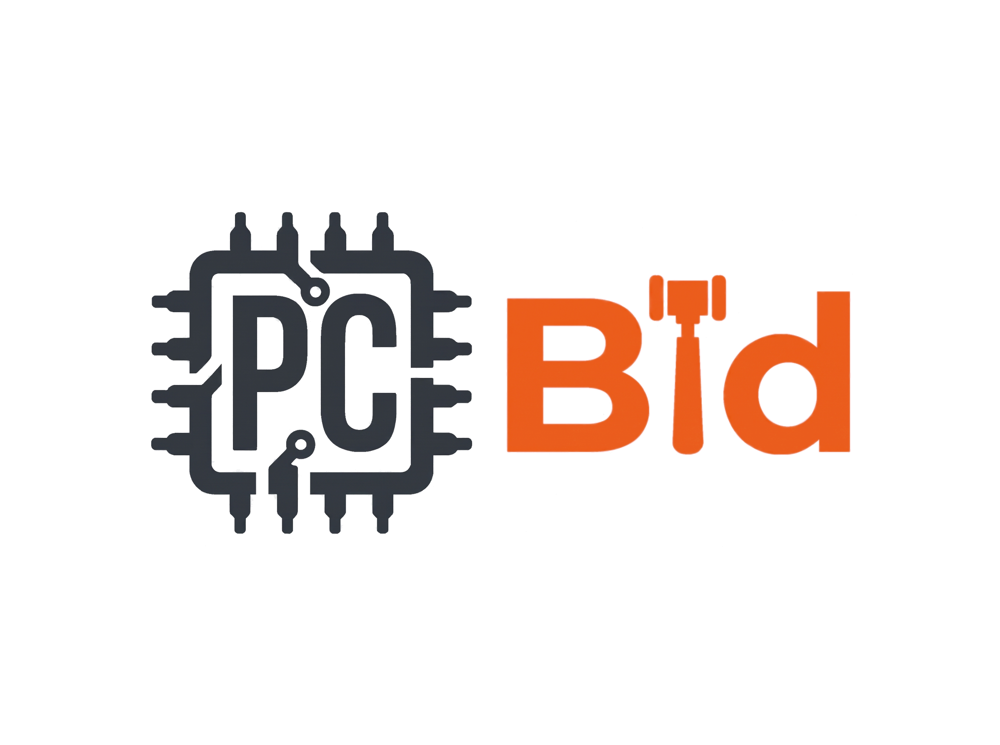

<p align="center">
  
</p>

# PCBid - Website Đấu Giá Linh Kiện PC Cũ

Đồ án môn học: **IE104 - Internet & Công nghệ Web**  
Giảng viên hướng dẫn: **ThS. Võ Tấn Khoa**  
Trường: **Đại học Công nghệ Thông tin - ĐHQG-HCM (UIT)**

---

## 1. Giới thiệu dự án

**PCBid** là nền tảng web mô phỏng sàn đấu giá trực tuyến dành riêng cho linh kiện máy tính cũ (Used PC Parts Auction). 

Khác với các trang web thương mại điện tử mua bán thông thường, cơ chế cốt lõi của PCBid tập trung hoàn toàn vào **đấu giá theo thời gian thực (Auction & Bidding Simulation)**: người bán đặt giá khởi điểm & thời hạn đấu giá, người mua theo dõi đồng hồ đếm ngược và tham gia trả giá cạnh tranh.

---

## 2. Công nghệ sử dụng & Ràng buộc kỹ thuật (Hard Constraints)

Dự án được xây dựng phục vụ yêu cầu học phần IE104 với tiêu chí **100% mã nguồn thuần (Vanilla)**:

* **Frontend:** HTML5 (Ngữ nghĩa semantic), CSS3 (Flexbox, CSS Grid, Responsive, BEM convention), Vanilla JavaScript (ES6+).
* **Kiến trúc Component:** Module hóa Header và Footer độc lập (`components/header/`, `components/footer/`), nạp động qua JavaScript để tái sử dụng xuyên suốt toàn bộ các trang.
* **Tuyệt đối KHÔNG sử dụng:**
  * Framework/Thư viện CSS: Bootstrap, Tailwind CSS, Bulma,...
  * Framework/Thư viện JS: React, Vue, Angular, jQuery,...
  * Backend & Server: Node.js, Express, Python/Django, PHP, Spring Boot,...
  * Cơ sở dữ liệu thật: MySQL, MongoDB, Firebase, Supabase,...
* **Mô phỏng dữ liệu & Trạng thái:**
  * Dữ liệu khởi tạo (mock data): Các file `.json` hoặc hằng số dữ liệu trong Javascript (`data/products.json`, `js/data.js`).
  * Lưu trữ trạng thái phiên người dùng: `localStorage` & `sessionStorage` (phiên đăng nhập, lịch sử đặt giá, các sản phẩm mới đăng, danh sách theo dõi).
* **Triển khai (Deployment):** Static Hosting (GitHub Pages).

---

## 3. Danh sách 8 màn hình chính thức

Dự án đã chốt chính xác **8 màn hình** đáp ứng đầy đủ yêu cầu nghiệp vụ:

1. **Trang chủ (`index.html`)**:
   - Hero banner giới thiệu sàn đấu giá linh kiện PC cũ.
   - Danh mục linh kiện nổi bật (GPU, CPU, Mainboard, RAM, SSD/HDD, PSU).
   - Phiên đấu giá Hot nhất, phiên sắp kết thúc (Live Countdown).
   - Cam kết sàn (Bao test 7 ngày, kiểm định Furmark, MemTest86).
2. **Danh sách sản phẩm & Bộ lọc (`products.html`)**:
   - Bộ lọc linh kiện đa năng (danh mục, khoảng giá, tình trạng New/Like New/Used).
   - Sắp xếp (giá tăng/giảm, sắp hết hạn, lượt bid nhiều nhất).
   - Tìm kiếm từ khóa thời gian thực.
3. **Chi tiết phiên đấu giá (`product-detail.html`)**:
   - Gallery ảnh linh kiện và kiểm định thực tế.
   - Thông số kỹ thuật chi tiết, đánh giá tình trạng linh kiện.
   - Bảng so sánh giá thị trường linh kiện mới vs giá đấu hiện tại.
   - Bộ đếm thời gian ngược (Live Countdown).
   - Khung đặt giá (Bidding Box): Kiểm tra hợp lệ bước giá, tự động cập nhật giá cao nhất.
   - Lịch sử đặt giá (Bid history log).
4. **Tạo phiên đấu giá mới (`sell.html`)**:
   - Biểu mẫu đăng linh kiện đấu giá: Tên, loại linh kiện, thông số, ảnh demo, giá khởi điểm, bước giá, hạn kết thúc.
   - Form validation chuẩn HTML5/JS và lưu dữ liệu phiên vào `localStorage`.
5. **Đăng nhập (`login.html`)**:
   - Xác thực tài khoản mô phỏng, lưu trạng thái phiên đăng nhập vào `localStorage`.
6. **Đăng ký tài khoản (`register.html`)**:
   - Form đăng ký thành viên mới, khởi tạo số dư ví ảo mô phỏng ban đầu.
7. **Hồ sơ cá nhân & Đấu giá của tôi (`profile.html`)**:
   - Thông tin cá nhân người dùng, số dư ví ảo mô phỏng.
   - Tab quản lý phiên đấu giá đang tham gia (dẫn đầu / bị vượt giá).
   - Tab quản lý các phiên do chính người dùng đăng bán.
   - Tab danh sách theo dõi (Watchlist).
8. **Trang thông báo lỗi 404 (`404.html`)**:
   - Giao diện báo lỗi trang không tồn tại thân thiện, kèm nút điều hướng về Trang chủ.

---

## 4. Cấu trúc thư mục dự án

```text
pc-bid/
├── components/
│   ├── header/
│   │   ├── header.html        # Template HTML Header (Top bar, Search, Categories Nav)
│   │   ├── header.css         # Style BEM riêng cho Header
│   │   └── header.js          # Logic Header (Search, Active menu link, Category sync)
│   └── footer/
│       ├── footer.html        # Template HTML Footer 4 cột
│       └── footer.css         # Style BEM riêng cho Footer
├── css/
│   ├── reset.css              # Reset CSS mặc định trình duyệt
│   ├── style.css              # Biến màu sắc, typography, utilities toàn hệ thống
│   ├── home.css               # Style nội dung riêng cho Trang chủ
│   ├── products.css           # Style trang danh sách & bộ lọc
│   ├── product-detail.css     # Style chi tiết sản phẩm & phòng đấu giá
│   ├── sell.css               # Style trang đăng bán đấu giá
│   ├── auth.css               # Style trang đăng nhập / đăng ký
│   └── profile.css            # Style trang cá nhân & quản lý
├── js/
│   ├── data.js                # Mock dataset ban đầu (sản phẩm, tài khoản mẫu)
│   ├── storage.js             # Wrapper tiện ích đọc/ghi localStorage
│   ├── main.js                # Nạp component động (#app-header, #app-footer)
│   ├── products.js            # Logic bộ lọc, tìm kiếm, phân trang
│   ├── product-detail.js      # Logic đặt giá, validate bước giá, countdown
│   ├── sell.js                # Logic đăng bán sản phẩm mới
│   ├── auth.js                # Logic xác thực đăng nhập/đăng ký
│   └── profile.js             # Logic tab quản lý đấu giá & ví ảo
├── images/
│   ├── logo/                  # Logo PCBid các kích thước
│   ├── icons/                 # Vector SVG icon trích xuất từ Figma
│   ├── products/              # Hình ảnh linh kiện máy tính
│   └── banners/               # Banner quảng bá, slider
├── data/
│   └── products.json          # Mock data JSON sản phẩm
├── index.html
├── products.html
├── product-detail.html
├── sell.html
├── login.html
├── register.html
├── profile.html
├── 404.html
├── README.md
├── AGENTS.md
└── .gitignore
```

---

## 5. Quy chuẩn lập trình (Coding Conventions)

* **CSS:**
  * Áp dụng phương pháp đặt tên theo chuẩn **BEM** (`block__element--modifier`).
  * Tránh xung đột CSS giữa các trang bằng cách gắn id riêng cho `<body>` hoặc thẻ bao chính (ví dụ: `#home-page`, `#product-page`).
* **JavaScript:**
  * Đặt tên biến và hàm theo chuẩn **camelCase** rõ nghĩa (`currentBid`, `calculateTimeRemaining()`, `handlePlaceBid()`).
  * Tổ chức code theo mô-đun rõ ràng, sử dụng ES Modules (`import`/`export`), lắng nghe sự kiện khi DOM đã sẵn sàng (`DOMContentLoaded`).
* **HTML:**
  * Sử dụng thẻ ngữ nghĩa (`<header>`, `<nav>`, `<main>`, `<section>`, `<article>`, `<aside>`, `<footer>`).
  * Mọi ảnh phải có thuộc tính `alt`, ưu tiên `loading="lazy"` cho ảnh dưới khung nhìn.
  * Hợp chuẩn W3C Validator.

---

## 6. Quy trình làm việc nhóm & Git Workflow (Bắt buộc)

Để tránh xung đột mã nguồn và đảm bảo chất lượng code, nhóm áp dụng nghiêm ngặt quy trình **Feature Branch & Pull Request**:

1. **Tuyệt đối không push trực tiếp lên `main`**: Toàn bộ thay đổi phải thông qua Pull Request.
2. **Tạo nhánh mới (Feature Branch)** khi bắt đầu làm việc:
   ```bash
   git checkout main
   git pull origin main
   git checkout -b feat/<ten-tinh-nang>   # hoặc fix/<ten-loi>
   ```
3. **Phát triển và Commit**: Tuân thủ chuẩn Conventional Commits:
   - `feat: thêm bộ lọc sản phẩm theo mức giá`
   - `fix: xử lý lỗi đếm ngược thời gian đấu giá`
4. **Tạo Pull Request (PR)**:
   - Đẩy nhánh lên GitHub: `git push -u origin feat/<ten-tinh-nang>`
   - Mở Pull Request vào nhánh `main` kèm mô tả chi tiết và hình ảnh demo/kết quả test.
5. **Code Review & Merge**:
   - Ít nhất một thành viên khác trong nhóm/nhóm trưởng kiểm tra code và chạy thử nghiệm.
   - Chỉ khi được Approve thì mới được phép merge vào `main`.

---

## 7. Hướng dẫn chạy & Kiểm thử

1. Clone repository về máy:
   ```bash
   git clone https://github.com/PC-BID-Organization/pc-bid.git
   cd pc-bid
   ```
2. Mở thư mục dự án bằng **Visual Studio Code**.
3. Cài đặt tiện ích mở rộng **Live Server** trên VS Code.
4. Click chuột phải vào file `index.html` và chọn **Open with Live Server** (cần thiết để nạp component Header/Footer qua HTTP request cục bộ tránh lỗi CORS).
5. Dự án thuần Frontend, không cần cài đặt `npm` hay server backend.
